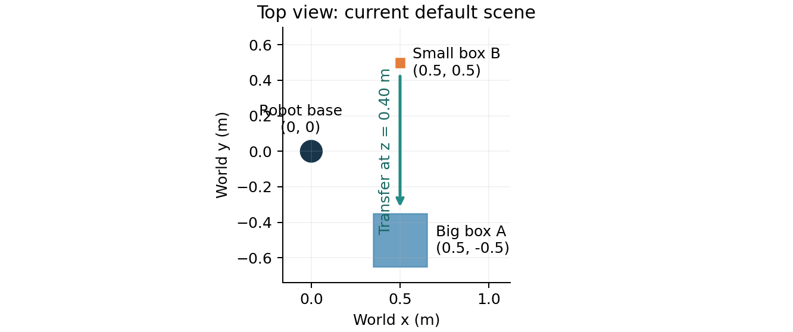
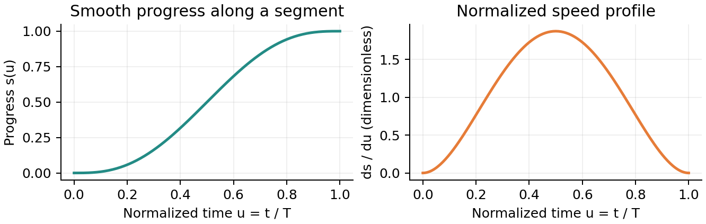

# GP7 simulation
Functionality & code guide

A practical guide to inverse kinematics, trajectory planning and speed handling in this repository.

Source snapshot: 490bcbc. All paths are relative to gp7_ros2/. Source references are clickable and pinned to this commit.

## What the simulation does

A six-axis GP7 arm opens its adaptive gripper, approaches the small box, lowers to grasp it, lifts and transfers it, places it on the big box, releases it and retracts. Joint and box feedback are checked throughout the sequence.



| Object / target | World coordinates (metres) |
| --- | --- |
| Robot base | (0, 0, 0) |
| Small box B: bottom / centre | (0.5, 0.5, 0) / (0.5, 0.5, 0.025) |
| Big box A: bottom / centre | (0.5, -0.5, 0) / (0.5, -0.5, 0.10) |
| Small box after placement: centre | (0.5, -0.5, 0.225) |

The big box is 0.30 x 0.30 x 0.20 m; the small box is 0.05 m on each side. Ground position refers to the bottom of a box. Gazebo model poses use its centre.

[Scene geometry and box positions | gp7_gazebo/worlds/pick_place.sdf:14](https://github.com/codingNR29/EN3563-Robot-arm/blob/490bcbcbc6ac992325a9945e9226eaf82d763655/gp7_ros2/gp7_gazebo/worlds/pick_place.sdf#L14)

# 1. Find the functionality

Start with pick_place_node.py: its run() method connects the planner, IK solver, gripper and controller.

| Functionality | File / entry point |
| --- | --- |
| Forward kinematics: angles to tool pose | gp7_motion/kinematics.py : Kinematics.fk() : line 40 |
| Inverse kinematics: tool pose to angles | gp7_motion/kinematics.py : Kinematics.ik() : line 51 |
| Choose pickup and placement waypoints | gp7_motion/reach.py : carry_waypoints() : line 43 |
| Cartesian path + joint velocity samples | gp7_motion/kinematics.py : segment() : line 68 |
| Initial approach in joint space | gp7_motion/kinematics.py : joint_segment() : line 93 |
| Execute and check motion | scripts/pick_place_node.py : move() : line 127; run() : line 162 |
| Controller interfaces and update rate | gp7_gazebo/config/ros2_controllers.yaml : line 1 |

The gp7_motion/ and scripts/ paths in the table are inside gp7_ros2_pkg/.

## How data moves through the system

```text
Launch: world + URDF + controllers
                    |
PickPlace.run(): read measured joints and box pose
                    |
carry_waypoints(): Cartesian targets in metres
                    |
segment() -> ik() -> joint positions q(t)
                    |
Timing + velocity samples -> FollowJointTrajectory
                    |
arm_controller -> gz_ros2_control -> Gazebo joints
                    |
Joint / box feedback -> arrival and placement checks
```

[Launch and startup | gp7_ros2_pkg/launch/pick_place.launch.py:21](https://github.com/codingNR29/EN3563-Robot-arm/blob/490bcbcbc6ac992325a9945e9226eaf82d763655/gp7_ros2/gp7_ros2_pkg/launch/pick_place.launch.py#L21)

[Full task sequence | gp7_ros2_pkg/scripts/pick_place_node.py:162](https://github.com/codingNR29/EN3563-Robot-arm/blob/490bcbcbc6ac992325a9945e9226eaf82d763655/gp7_ros2/gp7_ros2_pkg/scripts/pick_place_node.py#L162)

[Gazebo control integration | gp7_description/urdf/gp7.urdf:404](https://github.com/codingNR29/EN3563-Robot-arm/blob/490bcbcbc6ac992325a9945e9226eaf82d763655/gp7_ros2/gp7_description/urdf/gp7.urdf#L404)

The assignment task uses pick_place_node.py. arm_controller_node.py and demo_sequence_node.py provide separate preset/demo motions; they are not the numerical IK pipeline described here.

# 2. Inverse kinematics

[Open Kinematics.ik() | gp7_ros2_pkg/gp7_motion/kinematics.py:51](https://github.com/codingNR29/EN3563-Robot-arm/blob/490bcbcbc6ac992325a9945e9226eaf82d763655/gp7_ros2/gp7_ros2_pkg/gp7_motion/kinematics.py#L51)

## Question answered by IK

Given a desired position and orientation of the grasp frame, which six joint angles put the gripper there? Positions use metres; angles use radians. The grasp frame is the tool centre point (TCP) between the fingers.

```text
Input:  desired TCP position p, orientation R, seed q0
Output: q = [q1, q2, q3, q4, q5, q6]
Default orientation: DOWN = diag(1, -1, -1)
```

## How this implementation solves it

1. The constructor reads the chain from base_link to grasp_frame in the URDF. It collects each joint origin, rotation axis, position limits and velocity limit.

2. fk(q) multiplies the joint transforms to calculate a 4 x 4 tool transform. Its translation is the predicted TCP position; its 3 x 3 rotation is the predicted orientation.

3. ik() forms a six-component residual: three position errors and three orientation errors represented as a rotation vector.

```text
position_error = FK(q).translation - desired_position
rotation_error = rotvec(R_desired.T @ R_from_FK)
residual       = [position_error, rotation_error]
```

4. SciPy least_squares minimizes that residual while keeping each joint within its URDF bounds. A solution is accepted when the residual norm is below 1e-6; otherwise the function raises ValueError.

5. With restart=True, the solver can try the supplied seed plus 24 reproducible random seeds. During a Cartesian segment, the previous solution seeds the next sample to encourage a continuous joint path.

## Where IK is called

[Solve the pose above pickup and preflight all Cartesian segments | gp7_ros2_pkg/scripts/pick_place_node.py:175](https://github.com/codingNR29/EN3563-Robot-arm/blob/490bcbcbc6ac992325a9945e9226eaf82d763655/gp7_ros2/gp7_ros2_pkg/scripts/pick_place_node.py#L175)

[Solve each Cartesian sample using the previous joint solution | gp7_ros2_pkg/gp7_motion/kinematics.py:79](https://github.com/codingNR29/EN3563-Robot-arm/blob/490bcbcbc6ac992325a9945e9226eaf82d763655/gp7_ros2/gp7_ros2_pkg/gp7_motion/kinematics.py#L79)

[Read the URDF chain and joint limits | gp7_ros2_pkg/gp7_motion/kinematics.py:12](https://github.com/codingNR29/EN3563-Robot-arm/blob/490bcbcbc6ac992325a9945e9226eaf82d763655/gp7_ros2/gp7_ros2_pkg/gp7_motion/kinematics.py#L12)

[Forward kinematics used inside IK | gp7_ros2_pkg/gp7_motion/kinematics.py:40](https://github.com/codingNR29/EN3563-Robot-arm/blob/490bcbcbc6ac992325a9945e9226eaf82d763655/gp7_ros2/gp7_ros2_pkg/gp7_motion/kinematics.py#L40)

This is numerical IK derived from URDF transforms. There is no separate closed-form DH inverse solution or MoveIt planning call here. The residual mixes metres and radians without explicit weighting, so its threshold is a solver acceptance test, not a physical accuracy claim.

# 3. Trajectory planning

[Route selection: carry_waypoints() | gp7_ros2_pkg/gp7_motion/reach.py:43](https://github.com/codingNR29/EN3563-Robot-arm/blob/490bcbcbc6ac992325a9945e9226eaf82d763655/gp7_ros2/gp7_ros2_pkg/gp7_motion/reach.py#L43)

[Cartesian interpolation: segment() | gp7_ros2_pkg/gp7_motion/kinematics.py:68](https://github.com/codingNR29/EN3563-Robot-arm/blob/490bcbcbc6ac992325a9945e9226eaf82d763655/gp7_ros2/gp7_ros2_pkg/gp7_motion/kinematics.py#L68)

The route is a sequence of selected waypoints. Each Cartesian segment moves the TCP along a straight line while keeping the downward orientation fixed.

| Stage | TCP target (m) | Nominal time |
| --- | --- | --- |
| Approach above pickup | (0.5, 0.5, 0.40) | 8 s; joint space |
| Descend, then close and attach | (0.5, 0.5, 0.025) | 5 s |
| Lift | (0.5, 0.5, 0.40) | 5 s |
| Transfer above big box | (0.5, -0.5, 0.40) | 6 s |
| Lower, then detach and open | (0.5, -0.5, 0.226) | 4 s |
| Retract | (0.5, -0.5, 0.40) | 4 s |

The lowering target is 1 mm above the expected resting centre (z=0.225 m); the released box settles under gravity. Segment times can grow to meet joint speed limits. Gripper and settling time are additional.

## Smooth timing along each segment

```text
u = t / T
s(u) = 10*u^3 - 15*u^4 + 6*u^5
p(t) = p_start + s(u) * (p_end - p_start)
```



The quintic blend starts and ends with zero ideal path speed and acceleration. segment() samples at a nominal 0.05 s interval, solves IK at each point and rejects adjacent joint jumps greater than 0.15 rad. Time stretching increases the final sample interval.

The initial approach uses joint_segment(): it blends joint angles directly, so the TCP need not follow a straight line. The whole route is checked kinematically before the first arm move. These checks do not provide obstacle or self-collision detection.

# 4. Velocity & execution

## Where the arm speed is controlled

[Cartesian segment: estimate velocities and stretch time | gp7_ros2_pkg/gp7_motion/kinematics.py:85](https://github.com/codingNR29/EN3563-Robot-arm/blob/490bcbcbc6ac992325a9945e9226eaf82d763655/gp7_ros2/gp7_ros2_pkg/gp7_motion/kinematics.py#L85)

[Joint approach: analytic velocities and time stretching | gp7_ros2_pkg/gp7_motion/kinematics.py:93](https://github.com/codingNR29/EN3563-Robot-arm/blob/490bcbcbc6ac992325a9945e9226eaf82d763655/gp7_ros2/gp7_ros2_pkg/gp7_motion/kinematics.py#L93)

```text
limit[j] = min(URDF_velocity_limit[j], 0.5)  # rad/s
v = gradient(q_samples, sample_times)
stretch = max(1, max(abs(v) / limit))
sample_times *= stretch
v /= stretch
```

The Cartesian routine estimates joint speeds from the sampled joint positions. If any exceeds its limit, the entire segment slows down. Positions and the geometric path stay the same. Endpoint velocity samples are set to zero.

For the initial joint-space approach, joint_segment() computes velocities analytically from the quintic derivative, then applies the same speed scaling. Example: a sampled peak of 0.8 rad/s against a 0.5 rad/s limit gives a 1.6x longer duration.

## What is actually sent to the controller

[Build and send the FollowJointTrajectory goal | gp7_ros2_pkg/scripts/pick_place_node.py:127](https://github.com/codingNR29/EN3563-Robot-arm/blob/490bcbcbc6ac992325a9945e9226eaf82d763655/gp7_ros2/gp7_ros2_pkg/scripts/pick_place_node.py#L127)

```text
JointTrajectoryPoint(
    positions=q.tolist(),
    velocities=v.tolist(),
    time_from_start=...)

Action: /arm_controller/follow_joint_trajectory
```

Each point contains six desired joint positions, six velocity samples and a timestamp. The YAML selects JointTrajectoryController and a position command interface. Position and velocity are available as state interfaces. The controller manager is configured at 100 Hz.

[Arm command and state interfaces | gp7_gazebo/config/ros2_controllers.yaml:15](https://github.com/codingNR29/EN3563-Robot-arm/blob/490bcbcbc6ac992325a9945e9226eaf82d763655/gp7_ros2/gp7_gazebo/config/ros2_controllers.yaml#L15)

## How to describe this accurately

The implementation performs velocity-limited trajectory generation and sends position trajectories with velocity samples. It does not configure a dedicated velocity-command controller or implement a custom velocity PID loop. The explicit speed cap applies to calculated samples; it is not a proof that every continuous or measured speed stays below the cap.

## Gripper motion

[Smooth gripper position commands | gp7_ros2_pkg/scripts/pick_place_node.py:100](https://github.com/codingNR29/EN3563-Robot-arm/blob/490bcbcbc6ac992325a9945e9226eaf82d763655/gp7_ros2/gp7_ros2_pkg/scripts/pick_place_node.py#L100)

fingers() publishes a quintic position ramp to /gripper_controller/commands, nominally every 0.02 s. Its duration uses abs(angle_change)/0.25 with a one-second minimum. The value 0.25 sets duration; it is not a hard peak velocity cap, because the quintic derivative peaks at 1.875.

# 5. Run, verify & modify

## Start the task

```text
cd /home/banula/ros2_ws/src
./gp7_ros2/run_pick_place.sh

# Scene inspection without robot motion:
./gp7_ros2/run_pick_place.sh run_task:=false
```

Close the old launch with Ctrl+C before restarting. The helper selects this checkout's ROS environment. A successful completed task logs PICK AND PLACE VERIFIED.

## Change the right settings together

| Change | Where to edit |
| --- | --- |
| Small-box pickup coordinates | pick_place.launch.py:27 and node defaults:29; keep the SDF fallback pose aligned. |
| Big-box location / placement target | pick_place.sdf:15, launch parameters:62, node defaults:32. |
| Lift height and waypoint durations | reach.py:43 (carry_waypoints). Initial approach duration: kinematics.py:93. |
| Arm speed cap | kinematics.py:87 and :99. Both use min(URDF limit, 0.5). |
| Joint geometry / physical limits | gp7_description/urdf/gp7.urdf; constructor reads these into the solver. |

## What is verified

Six existing offline tests passed during preparation of this guide: dimensions, home FK, default-route interpolation, far-route reach and interpolation, gripper preservation, and rejection of an unreachable target.

```text
PYTHONPATH=gp7_ros2/gp7_ros2_pkg python3 -m unittest discover \
  -s gp7_ros2/gp7_ros2_pkg/test -v
```

[Open the offline checks | gp7_ros2_pkg/test/test_kinematics.py:1](https://github.com/codingNR29/EN3563-Robot-arm/blob/490bcbcbc6ac992325a9945e9226eaf82d763655/gp7_ros2/gp7_ros2_pkg/test/test_kinematics.py#L1)

At runtime, move() checks action success and measured joint arrival (0.015 rad tolerance). run() checks grasp proximity (4 mm), final box position (8 mm) and orientation (1 degree), with feedback freshness checks.

[Motion completion checks | gp7_ros2_pkg/scripts/pick_place_node.py:149](https://github.com/codingNR29/EN3563-Robot-arm/blob/490bcbcbc6ac992325a9945e9226eaf82d763655/gp7_ros2/gp7_ros2_pkg/scripts/pick_place_node.py#L149)

[Grasp and placement checks | gp7_ros2_pkg/scripts/pick_place_node.py:188](https://github.com/codingNR29/EN3563-Robot-arm/blob/490bcbcbc6ac992325a9945e9226eaf82d763655/gp7_ros2/gp7_ros2_pkg/scripts/pick_place_node.py#L188)

## Limits of this simulation

No new Gazebo run was performed for this guide. Offline IK success does not verify collision clearance at the current box locations. The object is retained by an idealized detachable fixed joint after finger closure; this does not establish a friction-based physical grasp. Earlier recorded simulation results in PICK_PLACE.md used previous scene positions.

[Idealized grasp constraint | gp7_ros2_pkg/gp7_motion/model.py:5](https://github.com/codingNR29/EN3563-Robot-arm/blob/490bcbcbc6ac992325a9945e9226eaf82d763655/gp7_ros2/gp7_ros2_pkg/gp7_motion/model.py#L5)

